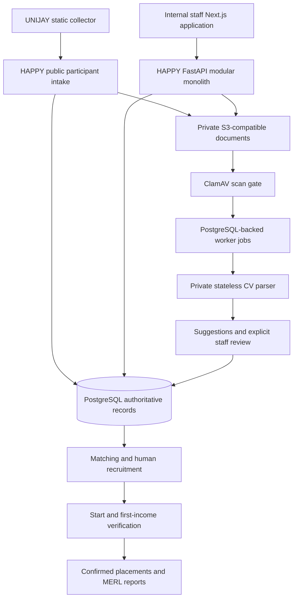

# HAPPY MVP Production Readiness Audit

Audit date: **29 October 2026, Africa/Accra**. Initial pass: **audit only**.

Scope: independently fetched HAPPY-ONE and UNIJAY-FASHION-DATA-COLLECTION, their current local working trees, GitHub metadata, source, tests, migrations, deployment definitions and local runtime. No application remediation, commit, push, merge, deployment, historical import or external notification was performed. Local dependencies and the existing optimized application were started for verification. Audit scripts, synthetic fixtures, private evidence and this report were created. Generated `next-env.d.ts` was restored byte-for-byte after the build.

Evidence terminology: **VERIFIED**, **PARTIALLY VERIFIED**, **NOT VERIFIED**, **FAILED**, **NOT APPLICABLE**, **REQUIRES EXTERNAL VALIDATION**. Verification always has an environment and scope. A passing regression suite does not certify untested inputs or a hosted release.

## 1. Executive Verdict

**LOCALLY INTEGRATED. NO-GO for a production pilot.**

The principal MVP domains are implemented and most have substantial local acceptance evidence. The modular monolith, PostgreSQL authority, public UNIJAY collector, private advisory parser and human recruitment decisions fit a small pilot. Enterprise infrastructure is unnecessary.

One **P0** was reproduced: first-income confirmation accepts a future actual receipt date and confirms the placement immediately. A separate **P1** accepts a rejected evidence document belonging to another participant. These are authenticated validation defects; they do not establish an authentication bypass or successful document download.

Additional blockers concern a reviewable release, privacy/verification decisions, installed dependency security, provider deployment, private storage, backup selection, complete recovery, alert delivery and operational acceptance. A fresh performance gate also failed because participant-list SQL grows per row, despite zero sampled endpoint errors.

- **MVP feature completion: 56% under the requested 0–5 maturity rubric.** This deliberately includes operational proof; it does not mean 44% of application code is missing.
- **MVP production readiness: 40%.** A P0 is a release veto regardless of percentage.
- **Remaining: 1 P0, 10 P1 recommendation packages, 6 external acceptance gates, 3 nonblocking improvement packages.** These overlap; they are not 20 separate implementation projects.

## 2. Release Identity

| Item | HAPPY-ONE | UNIJAY-FASHION-DATA-COLLECTION |
|---|---|---|
| Current branch | `feature/unijay-production-consolidation` | `feature/happy-public-intake` |
| Local HEAD and fetched branch HEAD | `139207a332f8e63d40ab6287ab03407e16390943` | `cd1c22526ba536207e0e08c5b633065a8c10e029` |
| Latest branch commit, UTC | 2026-10-28 03:54:23 | 2026-10-27 20:34:05 |
| Default branch / remote HEAD | `main` | `main` |
| Fetched default-branch SHA | `136cc959539e2b311be60f289211f18e8f4f9c41` | `ce389b202e48aa3823a28942f453c421c187b135` |
| Committed ahead / behind upstream | 0 / 0 | 0 / 0 |
| Working tree at source baseline | 40 tracked modifications, 11 untracked files | 2 tracked modifications; no untracked files |
| Active PRs | Draft #2 to integration branch; draft #1 to development | None returned |
| Protected branches | `main`, `integration/happy-ecosystem` | None returned |
| Standalone hosted CI | Published HAPPY SHA passed | No Actions runs returned |

HAPPY also has local `development` at `136cc95`, local `integration/happy-ecosystem` at `9da0e8e`, and fetched integration at `15facc8`. These differences were observed after fetch, not inferred from old documents. Repositories remain independent.

Current local migration head and live database: **`0041_income_availability`**. The newly added 0040/0041 migration files are untracked, so they are not in the published HAPPY SHA. Release version is **`1.0.0-rc.1`**; no local release tags were returned. A version string is not an immutable release identity for a dirty working tree.

[HAPPY CI run 40629320039](https://github.com/OffgengStudios/HAPPY-ONE/actions/runs/40629320039) passed all five jobs for `139207a`: platform, cv-parser, unijay, integration-contracts and retained-legacy-contracts. The repository variable `UNIJAY_INTAKE_REF` is pinned to `cd1c22526ba536207e0e08c5b633065a8c10e029`.

Important local-only work includes independent IDs, lifecycle dates and event ages, baseline income, individual training modules, placement details, independent employment outcomes, programme XLSX export, password controls and their tests. The 11 untracked paths and SHA-256 fingerprints of changed files are in private `repository-inventory.json`. The two UNIJAY changes concern retained Apps Script and its README, not the active public transport.

Production Render services reference `main`, which lacks the current production manifest, private parser Dockerfile and operational-state migration checked by this audit. The proposed release must be published and promoted before those service definitions can represent the audited product. GitHub deployment queries returned no deployment records; this is not proof that an unrelated external account has no deployment.

## 3. MVP Scope

Included: public UNIJAY registration; staff authentication/RBAC; Supply, onboarding and protected IDs; internal Demand; private documents and scanning; advisory CV extraction and review; matching and recruitment; starts, income verification and placement; training and individual outcomes; MERL; basic reports/exports; administration, audit, durable jobs, backups, monitoring and recovery.

Excluded: participant accounts, production HAMIS or Employer Portal, WhatsApp, Sheets as a backend, historical participant imports, Kubernetes, Kafka, microservices, active-active infrastructure, native mobile apps, advanced BI and enterprise availability.

Programme age classifications, Outreach treatment, income bands and unapproved outcome-counting rules remain explicitly unresolved. Do not manufacture these metrics to increase completeness. Restricted operational exports can remain available while those particular classifications are unavailable.

## 4. Architecture



The current local runtime uses staff :3300, API :8100, collector :8865/unijay/, private parser :8130, scanner :13310, storage :9000 and PostgreSQL :55433. Local HTTP/development settings are intended for synthetic self-testing, not real participant collection.

| Component / location | Classification | Observation |
|---|---|---|
| `HAPPY_PLATFORM_CODEX/apps/api` | ACTIVE MVP | Domain API and authorization |
| `HAPPY_PLATFORM_CODEX/apps/web` | ACTIVE MVP | Internal staff application |
| Independent UNIJAY `data-collection-tool` and `build.mjs` | ACTIVE MVP | Static collector posts to HAPPY |
| `CV-Parser-main/cv_system_output/happy_service.py` | SUPPORTING MVP | Machine-authenticated stateless extraction |
| `apps/api/app/workers/operations.py` | SUPPORTING MVP | Report and parser polling; legacy polling disabled |
| `database/migrations` | SUPPORTING MVP | Alembic, local head 0041 |
| Root `.github/workflows/ci.yml`, deployment definitions, tests/docs | SUPPORTING MVP | Some documentation is stale |
| Root `frontend/`, `portal/` | LEGACY | Retained contracts; not release frontends |
| `app/integrations/hamis`, `employer_portal`, employer intake router | LEGACY / TEST-ONLY in active release | Release settings prohibit enabling them |
| Standalone parser candidate UI, Sheets/WhatsApp and separate matching | LEGACY | Private HAPPY service does not import standalone candidate API |
| UNIJAY `Code.gs`, Apps Script configuration/README | LEGACY | Excluded from build; external old deployment revocation not verified |

## 5. Component Status

Tested below means local acceptance of the stated domain, subject to listed defects. Deployed refers to the currently verified local runtime only. **No component has hosted production operational acceptance.**

| Component | Implemented | Tested | Deployed | Operationally Verified | Score / 5 |
|---|---|---|---|---|---:|
| UNIJAY | VERIFIED | VERIFIED contracts, build, 3 browser scenarios | Local | Local only | 3 |
| Supply | VERIFIED | VERIFIED including IDs, gates, baseline and ages | Local | Local only | 3 |
| Demand | VERIFIED | VERIFIED internal employer/vacancy flow | Local | Local only | 3 |
| CV Parser | VERIFIED | VERIFIED 4 reruns + 22 parser tests and golden test | Local private | Local only | 3 |
| Matching | VERIFIED | VERIFIED approved-profile and human gates | Local | Local only | 3 |
| Recruitment | VERIFIED | VERIFIED transitions and history | Local | Local only | 3 |
| Placement | VERIFIED | FAILED future-income input; other gates pass | Local | Local only; correctness blocker | 2 |
| MERL | VERIFIED | VERIFIED follow-ups/outcomes and revisions | Local | Local only | 3 |
| Reporting | VERIFIED | VERIFIED counts, permissions and exports; inherits placement defect | Local | Local only | 3 |
| IAM | VERIFIED | VERIFIED negative access, sessions, CSRF, TOTP/OIDC contracts | Local | Provider SSO not verified | 3 |
| Documents | VERIFIED | VERIFIED private storage, bounds, real scanner | Local | R2 not verified | 3 |
| Audit | VERIFIED | VERIFIED append-only history and permissions | Local | Local only | 3 |
| Workers | VERIFIED | VERIFIED actual process death, lease expiry, retry and claims | Local | Hosted restart not verified | 3 |
| PostgreSQL | VERIFIED | VERIFIED fresh migration, replay, data preservation, drift | Local | Hosted load/recovery not verified | 3 |
| Security | VERIFIED controls | PARTIALLY VERIFIED; dependency/evidence findings | Local | No penetration-test certification | 2 |
| Backup | VERIFIED | VERIFIED private dump/checksum; scheduler contracts | Local manual | No scheduled provider success recorded | 3 |
| Recovery | VERIFIED DB tooling | PARTIALLY VERIFIED database restore; selector FAILED | Local disposable target | Full DR not verified | 2 |
| Monitoring | VERIFIED code | VERIFIED local state/metrics/privacy tests | Local checkpoints | Receiver/alert delivery not verified | 2 |
| CI | VERIFIED | VERIFIED hosted published SHA; current dirty tree local checks | GitHub | Latest local changes not covered remotely | 3 |
| Deployment | VERIFIED definitions | PARTIALLY VERIFIED native optimized build | Local | Linux containers/ARM/provider not verified | 2 |

## 6. Golden Flow

The full business chain was **reconstructed from freshly executed tests**, principally `test_unijay_internal_demand_golden_workflow_uses_real_parser`, with separate real-scanner acceptance. That golden test mocks scan success and invokes parser processing directly; it is not a single live hosted traversal of every service. Business success uses API actions; synthetic fixture seeding does not establish business acceptance by itself.

| Stage | Status | Evidence |
|---|---|---|
| UNIJAY structured names, interests and versioned consent | PASS local | Contract, real Node payload integration and browser retry tests |
| Direct public intake without accounts | PASS local | Public tests, config, no credentialed browser transport |
| Protected Ghana Card / duplicate review | PASS local | Encrypted ID/HMAC tests; concurrent duplicate handling; no auto-merge |
| Supply review and onboarding | PASS local | Consent/required-field and submission-gate tests |
| CV validation and private upload | PASS local | Public/private upload and integrity tests |
| Scan → permission-controlled download | PASS local, separate test | Actual ClamAV PDF/DOCX/EICAR, outage and rescan acceptance |
| Private parser → suggestions | PASS local | Real parser subprocess in golden test and transport suites |
| Human approve/edit/reject → profile | PASS local | No authoritative change before review; append-only review |
| Internal organization/contact/partnership/vacancy/requirements | PASS local | Golden API flow and Demand tests |
| Match suggestions → recruiter review → submission/interview/selection | PASS local | Explicit transitions, onboarding and consent gates |
| Actual start → awaiting income | PASS local | Selected/start not counted as confirmed; capacity race test |
| First-income confirmation | FAIL validation boundary | Future actual receipt and foreign rejected evidence accepted |
| Historical confirmed achievement and replay | PASS ordinary cases | Later exit retained; concurrent replay creates one achievement |
| MERL and authoritative reports | PARTIAL | Ordinary golden flow passes; invalid confirmations can contaminate counts |
| One complete deployed chain | NOT VERIFIED | No target-provider end-to-end acceptance |

## 7. P0 Findings

**P0 OPEN: 1. MVP-001 — Future actual income confirms a placement now.**

On 29 October 2026, a legitimate synthetic selected candidate was started through the API. Posting first-income confirmation with `actual_income_received_date=2027-10-29` returned **HTTP 200**, `status=CONFIRMED` and a current `confirmed_at`.

`apps/api/app/modules/placement/service.py:358` rejects income before start but does not reject income after the programme's current date. `correct_confirmation` must also be reviewed. Reporting counts `confirmed_at` in `reporting/service.py`, so this permits achievement before receipt could have occurred. This violates core outcome correctness even though an authorized staff user initiates it.

The two audit reproductions passing means **the defects were reproduced**, not that the behavior is acceptable. See private `placement-future_income.json` and `placement-audit.log`.

## 8. P1 Findings

| ID | Blocker | Evidence state |
|---|---|---|
| MVP-002 | Release contains unpublished lifecycle code/migrations; target `main` is older; UNIJAY unprotected | VERIFIED |
| MVP-003 | No validated complete target deployment, production configuration, ARM images or restart path | REQUIRES EXTERNAL VALIDATION |
| MVP-004 | Confirmation accepts another participant's rejected evidence document | FAILED: API HTTP 200 / CONFIRMED |
| MVP-005 | Production privacy, minimum verification procedure, retention and actual staff permission assignments are not approved/proven | REQUIRES EXTERNAL VALIDATION |
| MVP-006 | Installed `dnspython 2.8.0` has a high-severity reported vulnerability | FAILED dependency audit |
| MVP-007 | Actual private R2 behavior, credential separation and object recovery are not accepted | REQUIRES EXTERNAL VALIDATION |
| MVP-008 | `restore-latest` ignores pagination and may select an old recovery point | FAILED mocked truncated-listing reproduction |
| MVP-009 | Hourly RPO and two-hour full application RTO unproven | REQUIRES EXTERNAL VALIDATION |
| MVP-010 | No verified off-host monitoring/alert delivery; scheduled backup/restore state absent | PARTIALLY VERIFIED |
| MVP-011 | Target golden flow, failure acceptance and owner UAT have not run for immutable release | NOT VERIFIED |

No old blocker was assumed open merely because an old report listed it. Hosted CI, pinned UNIJAY ref, protected HAPPY release branches, real local scanner and worker crash recovery now have affirmative evidence.

## 9. P2 Findings

- **MVP-012:** participant checklist introduces one sensitive-profile lookup per row. The 10,000-participant baseline fails its bounded-query assertion. At observed pilot sample sizes this is a performance improvement, not evidence of an unusable system.
- **MVP-013:** comprehensive keyboard/focus/dialog/contrast and assistive-technology review remains incomplete. Fresh browser automation proves selected labeled controls and layout, not WCAG conformance. Any subsequently found work-blocking accessibility defect must be escalated.
- **MVP-014:** stale operational/integration documentation and retained legacy code impose maintenance cost. Reduce active release scope and stale instructions without changing the agreed repository layout or weakening security.

## 10. Security

| Area | Result and practical limit |
|---|---|
| Authentication | Argon2 password hashing, generic failures, account/IP throttles, rotated opaque server sessions. Fresh login/logout/revocation checks pass. |
| Cookies and expiry | Secure in staging/production, HttpOnly session, SameSite Lax; default 8-hour absolute and 30-minute idle expiry. Local development intentionally uses HTTP. |
| CSRF / CORS | Mutation origin and session-bound CSRF enforced server-side. Live missing-token logout returns 403; untrusted preflight returns 400; approved origin succeeds. |
| RBAC / IDOR | Permission dependencies, other-user session/export denials and negative role tests pass. This is focused testing, not exhaustive route-by-route penetration testing. Evidence-reference binding fails separately. |
| Password reset / deactivation | Administrator password replacement and session revocation implemented/tested. No self-service email-reset deployment proven; a controlled pilot needs a documented authorized recovery procedure. |
| MFA / OIDC | Encrypted TOTP enrollment/recovery, challenge consumption and provider validation contracts tested. No actual organizational SSO acceptance or enforced privileged-user enrollment proven. |
| Ghana Card / Voter ID | Independent encrypted ciphertext plus keyed HMAC lookup; unique fingerprints, generic duplicate errors and authorized review. Serialization exposes presence, not raw ID/hash. Migration preservation verified with synthetic ciphertext. |
| General PII | DOB and other profile data are permission-scoped API fields, not all application-encrypted columns. Hosted disk/backup encryption, access and retention need provider acceptance. |
| Documents | Authenticated download, private object keys, checksums, size limits, PDF/DOCX structural validation, archive gates and actual scan tests pass. Confirmation can nevertheless attach rejected/foreign evidence. |
| Exports | Default programme XLSX leaves full IDs blank. Explicit identity export requires sensitive export and participant-sensitive permission, acknowledgement and audit. This is an intentional controlled plaintext export, requiring handling policy. CSV neutralization and literal XLSX cells are tested. |
| Logs / telemetry | Route templates/request IDs; privacy filters remove raw URLs, SQL parameters, span events and unsafe exception details. Existing negative/sentinel tests pass. No real identity-log exposure established in the active tested path. |
| Secrets | Focused tracked-file credential-pattern scan found no private-key/AWS-access-key/GitHub-token match; tracked env files are examples. This is not comprehensive historical secret scanning or provider rotation proof. Private env/access/backup files were not published. |
| Public intake | No participant login, exact origins, DB-backed throttling, honeypot, receipt/idempotency controls; duplicate responses do not expose an existing participant. Public endpoints still need deployed proxy/client-IP and abuse tuning. |
| Parser | Machine credentials required; unauthenticated parse returns 401. Bounded payloads, supported extraction, errors and advisory review tested. Role suggestions exist; sector/industry are not separate authoritative parser outputs. |
| Scanner | Real ClamAV acceptance ran. Clean PDF/DOCX allowed; EICAR rejected; scanner outage leaves SCANNING and download blocked; authorized rescan recovers. Definition freshness/update supervision on target remains unverified. |
| XSS / SQL / redirects | Text rendering, parameterized SQL, formula protection and fixed/configured SSO destinations reviewed. No unrestricted dynamic SQL was identified in exercised input paths. No full penetration-test claim. |

Identity exposure inventory: literal Ghana Card-shaped values occur in synthetic tests and legacy/public HTML formatting examples; they are not evidence of real participant IDs. Full IDs necessarily travel in the registration request and appear only in an explicitly authorized identity export. The retained `Code.gs` writes plaintext IDs to a spreadsheet if separately deployed; it is excluded from the active build, but retirement/revocation of any old public deployment is **NOT VERIFIED**. It must not remain a parallel production collection path.

The fresh Python audit reports **CVE-2026-114605 / GHSA-45c3-73f7-pv4m**, installed dnspython 2.8.0; the maintainer identifies 2.9.0 as patched. Reachability/exploitability against HAPPY was not demonstrated. [Maintainer advisory](https://github.com/rthalley/dnspython/security/advisories/GHSA-45c3-73f7-pv4m). JavaScript production audit reports zero advisories among 68 dependencies. Broad Python version ranges and unpinned base images mean an old green CI run does not certify today's installed packages or a future container build.

## 11. Reliability

PostgreSQL is authoritative. Transactions, foreign keys, uniqueness, optimistic versions and row/advisory locks are present and tested. Concurrent public replay/duplicates, vacancy starts and income replay are exercised with independent real sessions. Starts serialize on vacancy capacity; replay produces one confirmation event. Document versions have uniqueness and participant write locking; no separate new simultaneous version/merge stress run was added in this audit.

Active durable jobs are parser and report jobs. PostgreSQL stores claims, attempt counts, lease owner/expiry, next attempt and terminal status. `SKIP LOCKED` claims, retry limits/backoff and expired-final-lease reconciliation exist. An actual worker process was terminated in a disposable environment, leases expired naturally, a fresh interpreter reconciled them and authorized retries were tested. Parser outages/restarts and private report output were also tested. Intentionally pending jobs and SCANNING documents require operators/recovery; they are not promised to complete during permanent dependency failure.

Local worker heartbeat is fresh, consecutive poll failures are zero and active report/parser queues have no stale leases. Aggregate operations are staff-protected. Killing or partitioning the deployed host and delivering an external dead-worker alert remain unproven. Continuous report work can take polling precedence over parser work; fairness under sustained export traffic is a nonblocking soak-test concern.

Health now returns live **200 (~15 ms)** and ready **200 (~31 ms)**. Unit/integration tests prove refused DB connections return 503 within the configured bound and do not affect liveness. Storage connect/read limits are 3 seconds with no retry. Database connection/pool limits exist; database SQL statement/lock deadlines and a stalled established-connection fault were not verified. Bound these at deployment and include them in failure acceptance.

## 12. Recovery

| Measure | Current evidence |
|---|---|
| Approved RPO | At most 1 hour |
| Approved RTO | At most 2 hours |
| Configured production snapshot interval | 30 minutes in current root Render manifest |
| Configured retention | 35-day default; production variable supplied externally |
| Current demonstrated production RPO | **NOT VERIFIED**; no successful scheduled provider backup checkpoint |
| Current demonstrated full application RTO | **NOT VERIFIED** |
| Local DB backup | Custom-format dump, 326,085 bytes, checksum/catalogue verified; ~0.843 s for this small local source |
| Local isolated database restore | **17.438 s**, revision 0041, disposable target removed |
| Object recovery | **NOT VERIFIED** on target provider |
| Identity encryption and lookup key recovery | **NOT VERIFIED** off-host |
| Config/network/TLS/application recovery | **NOT VERIFIED** |

An initial restore attempt using the application account failed CREATE DATABASE permission. The existing private local maintenance credential was then used successfully. This is appropriate privilege separation, not a reason to give the application CREATEDB. Restore credentials must stay with the isolated recovery operator/job.

Backup subprocess credentials are passed through a child-only environment, not argv; stderr and exceptions are sanitized. Checksum, manifest, upload pair, retention/failure contracts and CLI safety tests pass. Local creation/restoration does not establish scheduled upload, geography, deletion protection or off-host recoverability.

**Concrete selector defect:** `app/db/backup.py:254` uses a single `list_objects_v2`, ignoring `IsTruncated`/continuation. Audit storage returned an old first-page archive plus a continuation indicating newer objects; `restore_latest()` downloaded the old archive. At 48 dumps/day for 35 days there can be 1,680 dumps plus manifests, exceeding one page. Retention cleanup is paginated; restore selection is not. Fix selection and prove latest *complete, verified* recovery-point handling, including missing/corrupt manifest behavior and fallback/operator escalation.

A half-hour schedule can support the RPO only if completion/upload duration, failures and backup-age alerts leave sufficient margin. One dump per day is no longer the current manifest, so that former criticism would be wrong. No schedule alone guarantees RPO. Database backups do not recover deleted CVs or lost encryption keys.

## 13. Observability

Implemented: structured request logs, request IDs, OTLP traces/metrics with privacy filtering, parser/scanner results and durations, operational checkpoints, queue depth/age/stale leases, duplicate review backlog, auth failure aggregates, backup and restore success/failure timestamps.

Verified: fresh authenticated operations snapshot, worker heartbeat/poll success, protected anonymous denial and metric/privacy regression tests. Current local BACKUP/RESTORE scheduled timestamps are zero. Manual audit restore is recorded in this report, not fabricated as a scheduled provider success.

**NOT VERIFIED:** hosted collectors/dashboards, retention, uptime checks and delivery of actual API/DB/worker/scanner/parser/storage/backup/restore alerts to a staffed recipient. Code and webhook configuration are not delivery evidence. A backup process cannot alert when it never runs or the host is dead; off-host freshness/uptime checks are required.

Minimum pilot operations: external API readiness/TLS check, worker poll/queue-age and stale-lease alerts, scanner/parser failure/backlog, storage probe, backup age under the 1-hour RPO, restore-drill age/failure, auth failures, disk/memory/DB connection health; named primary/backup responders and a tested escalation path. A managed enterprise monitoring suite is unnecessary.

## 14. CI/CD

The current workflow runs PRs, and pushes to `main`/`development`. Feature-branch pushes alone do not trigger the push filter; the current feature's open PR supplied hosted runs. All five published-SHA jobs passed on Linux, including PostgreSQL service, private test storage, UNIJAY, parser, backend/frontend checks, production build, browser tests and dependency audits. `scripts/ci.py` includes migration/model drift checks.

There is no basis to call CI broken merely because the UNIJAY default branch is old: the current repository variable pins the actual tested intake commit. However, that mutable variable is not a versioned release manifest. Record both SHAs in the release and protect/review updates.

Fresh local results:

| Check | Result |
|---|---|
| Backend regression with integration + actual scanner enabled | 391 passed; 4 initial DB-startup errors |
| Exact affected parser integration rerun after dependency startup | 4 passed; 391 deselected |
| Combined backend coverage | All 395 collected test cases passed across these runs; **not one pristine full-suite run** |
| Separate parser service/contract suites | 22 passed |
| UNIJAY Node contracts | 2 passed |
| UNIJAY browser contracts | 3 scenarios passed: desktop/mobile multipart retry; unavailable notice fails closed |
| Backend Ruff / strict mypy / dependency consistency | Passed; mypy 136 source files |
| Workspace frontend lint/types | Passed |
| Fresh optimized staff + collector build | Passed |
| Staff read-only desktop/mobile login/navigation/logout | Passed selected sections; no JS errors or horizontal overflow |
| Python dependency audit | Failed: one reported vulnerable package |
| JavaScript production dependency audit | Passed: zero advisories |
| Synthetic capacity gate | Failed bounded-query-growth assertion |
| Added audit defect reproductions | 2 reproduced; defects remain open |

The first backend command started before PostgreSQL was available; it was an audit sequencing error. It was not classified as four product defects. No tests were silently disabled to get a green result. Current dirty-tree source has not had hosted Linux CI; do not reuse the previous green badge for it. No full web test suite was rerun locally during this audit; fresh read-only smoke coverage and the published-SHA browser suite have narrower scopes.

`main` and integration protection require five checks, an approving review, stale-review dismissal, admin enforcement and disallow force push/deletion. The `platform` required check is not app-bound (`app_id=null`); binding it to Actions is sensible hardening. UNIJAY has no protected branches or standalone CI runs. Retained legacy contract jobs are explicitly legacy tests, not active production architecture.

## 15. Deployment

Current root Render production definition includes API, staff, worker, private parser, half-hourly backup and weekly restore exercise; automatic production deployment is off, with preflight then migration. Scanner, PostgreSQL, private storage, telemetry and secrets need actual provisioning. Staging references the feature branch. The older platform Compose example contains API/web/DB/storage but omits worker/parser/scanner/backup scheduler/Caddy; it is not a complete Oracle deployment.

API and parser Dockerfiles use nonroot users; web uses a standalone Linux build. Docker is unavailable here, so amd64 image builds, ARM64 manifests/native wheels, container boot/health and shutdown were **NOT VERIFIED**. Native Windows build success does not prove either container architecture. PostgreSQL server/client compatibility must also be tested on the selected image/version; local tests used the installed PostgreSQL 18 tools, while CI/Compose specify PostgreSQL 16.

Current `self-test.env` fails production preflight for APP_ENV, production safety, HTTPS storage/alert/OTLP endpoints and exact HTTPS CORS origins. That is appropriate for its local-only purpose. It is not a valid production environment. No alternate production secret configuration was demonstrated; this audit did not alter private env values or provision services.

### Proposed free infrastructure

| Target | Assessment |
|---|---|
| Cloudflare Pages → UNIJAY | Technically suitable for this static `dist` build. Set exact release ref and HTTPS HAPPY API origin, CORS and security headers; verify deployed submission/retry. No Pages project/deployment acceptance shown. [Pages limits](https://developers.cloudflare.com/pages/platform/limits/) |
| Oracle A1 → Caddy/API/staff/worker/parser/ClamAV/PostgreSQL | Plausible small-pilot topology, **not yet an accepted deployment**. Current published free allowance is **2 OCPUs / 12 GB**, not an assumed 4 / 24. Home-region capacity can be unavailable and idle instances may be reclaimed. These constraints prevent promising replacement capacity inside 2 hours. [Oracle Always Free resources](https://docs.oracle.com/en-us/iaas/Content/FreeTier/freetier_topic-Always_Free_Resources.htm) |
| Cloudflare R2 → private documents/backups | S3-compatible core operations fit the adapter, subject to actual API/privacy/restore tests. Bucket creation currently sends `ACL=private`, while R2 documents ACL headers as unsupported; provision private R2 buckets through supported controls and test the adapter. Do not assume AWS bucket policy/versioning/replication APIs exist. [R2 compatibility](https://developers.cloudflare.com/r2/api/s3/api/) |
| Scanner sizing | Reserve memory for signatures and reload, not just application RSS. ClamAV documents 3 GiB minimum / 4 GiB preferred. This leaves a limited shared CPU/memory budget for the rest of a 12 GB VM. Bound parser/scan concurrency and run target load plus signature reload. [ClamAV sizing](https://docs.clamav.net/manual/Installing/Docker.html) |
| Free storage budget | R2 Standard free allowance is 10 GB-month with operation limits. At 1,680 retained dumps, average dump size would need to be under roughly 6 MB even if no allowance were used by documents. Measure growth and adjust retention architecture/budget without weakening RPO. [R2 pricing](https://developers.cloudflare.com/r2/pricing/) |

**Free-only hosting cannot currently be accepted as reliably guaranteeing RPO ≤1 hour / RTO ≤2 hours.** This is an engineering assessment from capacity/reclamation constraints and missing recovery proof, not a claim that the topology cannot run. Use a tested paid recovery fallback or sufficient reserved/retained replacement capacity if the owner retains those targets. Keep independent off-host data/key recovery. Availability is not supplied by object durability alone.

Minimum Oracle delivery still needs a complete versioned Compose/systemd arrangement, Caddy/TLS, private network bindings, startup dependencies, restart supervision, scanner update schedule, persistent DB volumes, backup/freshness timers, secret injection, firewall/proxy trust, resource limits, migration/rollback runbooks and operator access. No Kubernetes or extra queue service is required.

## 16. Performance

Fresh guarded baseline: 10,000 participants, 1,000 employers, 2,000 vacancies, 20,000 candidate-vacancy relationships, plus 100 confirmed placements and document metadata. Counts verified. Four concurrent in-process HTTP callers, 20 samples per route, real local PostgreSQL. Synthetic bulk inserts served capacity setup only; they did not bypass business workflow to establish golden-flow success.

| Endpoint sample | p50 ms | p95 ms | Error rate |
|---|---:|---:|---:|
| Participant list | 372.22 | 700.58 | 0% |
| Participant search | 215.57 | 470.77 | 0% |
| Vacancy list | 119.56 | 138.37 | 0% |
| Matching suggestions | 150.00 | 161.69 | 0% |
| Dashboard | 731.23 | 891.91 | 0% |
| Management KPIs | 819.79 | 1188.48 | 0% |
| Synchronous report export | 3272.94 | 3856.68 | 0% |

**Overall status FAILED:** participant query count rises from 14 at 5 rows to 34 at 25. `supply/service.py:148` loads SensitiveProfile in every checklist; `participant_views:283` batches people/consent but not these profiles. Fix batching without weakening Ghana Card/conditional-field checks or changing detail/list projections.

The assertion stopped the probe before its final memory/pool metrics were serialized: **peak RSS and peak DB pool usage NOT VERIFIED in this run**. Some slow-query EXPLAIN evidence is retained; selective search scanned/joined 10,000 rows (~35.5 ms local plan execution). There is no comprehensive deployed slow-query sample or soak acceptance. Tests and other audit activity shared this machine, so these are diagnostic measurements, not controlled cloud SLOs. Disposable dataset/schema cleanup was verified; no objects were created by the capacity probe.

The measured API does not demonstrate an enterprise-scale need or a failed small-pilot latency SLO. Agree pilot concurrency, latency/error budgets, dataset and resource headroom, then repeat on the target ARM VM including scanner reload, report work and backup overlap.

## 17. MVP Completion Score

Requested maturity scale: 0 absent; 1 prototype; 2 implemented but weak/unaccepted evidence; 3 locally accepted; 4 staging quality; 5 production operationally verified. An identified correctness failure limits the affected domain to 2. Scope is the current local tree, not only the published SHA.

| Domain | Weight % | Score |
|---|---:|---:|
| UNIJAY | 7 | 3 |
| Supply | 10 | 3 |
| Demand | 7 | 3 |
| CV Parser | 5 | 3 |
| Matching | 6 | 3 |
| Recruitment | 7 | 3 |
| Placement | 12 | 2 |
| MERL | 5 | 3 |
| Reporting | 5 | 3 |
| IAM | 7 | 3 |
| Documents | 6 | 3 |
| Audit | 3 | 3 |
| Workers | 4 | 3 |
| PostgreSQL | 4 | 3 |
| Security | 4 | 2 |
| Backup | 2 | 3 |
| Recovery | 2 | 2 |
| Monitoring | 1 | 2 |
| CI | 2 | 3 |
| Deployment | 1 | 2 |
| **Total** | **100** | **Weighted points 280 / 500** |

**MVP feature completion: 56%.** Formula: `sum(weight × score) / 5`. Core operational domains carry most weight. This is not a blind unweighted mean, source line count or reused old score. All 20 domains have implementation; the requested maturity denominator deliberately reserves 40% of a locally accepted feature for staging/operational proof. No unsupported percentage of “code complete” is asserted.

## 18. Production Readiness Score

Same 0–5 evidence scale, with explicit emphasis on correctness, security, data protection and recovery:

| Dimension | Weight % | Score / 5 |
|---|---:|---:|
| Application completeness | 10 | 3 |
| Application correctness | 15 | 2 |
| Security | 12 | 2 |
| Data protection | 10 | 2 |
| Reliability | 10 | 3 |
| Recoverability | 12 | 1 |
| Observability | 8 | 2 |
| CI/CD | 7 | 3 |
| Deployment | 6 | 1 |
| Operations | 4 | 1 |
| Performance | 3 | 2 |
| UAT readiness | 3 | 1 |
| **Total** | **100** | **202 / 500** |

**MVP production readiness: 40%** (40.4% before rounding). Local DB restore raises confidence in tooling; it does not raise full application recoverability to an accepted operational state. The independent P0 veto cannot be compensated by good scores elsewhere.

## 19. Distance to MVP

```text
Remaining P0: 1
Remaining P1: 10 recommendation packages
External validation gates: 6, overlapping the P1 work
Nonblocking improvement packages: 3
```

External gates: (1) actual compute/account plus ARM/container acceptance; (2) public TLS/CORS/private R2 and credential acceptance; (3) scheduled backups and complete timed recovery including keys/objects; (4) monitoring and delivered alerts; (5) programme/privacy/permission and verification-process approval; (6) immutable-release golden flow, security/failure acceptance and owner UAT.

Distance is concentrated in correctness and release/operational acceptance, rather than missing major product domains. Calendar duration cannot be supported from current evidence.

## 20. MVP Cut Line

### Must close before MVP

Close MVP-001 through MVP-011: future-income validation; evidence ownership/scan gates; reviewed immutable release and migrations; current dependency security; privacy/verification/retention and real staff permissions; complete deployment and private provider controls; paginated/latest verified backup selection; scheduled recovery points and complete recoverability; off-host monitoring/delivered alerts; target golden flow and UAT.

Only the policies actually needed for the pilot must be approved. Unapproved age/income classifications may stay unavailable. Notes-based income verification versus mandatory attached proof needs an explicit procedure; this audit does not invent one.

### Should close during pilot

Batch participant profile lookups and repeat the diagnostic baseline; manual accessibility and operational usability review; tighter dependency/image reproducibility; documented account recovery and privileged MFA checks; modest query/timeouts and queue fairness observations. Promote any reproducible security/data-loss/work-blocking issue discovered there to a launch blocker.

### Post-MVP

Advanced BI/forecasting and workflow automation, cosmetic UI refinements, broader legacy removal/refactoring and nonessential integrations. Do not add Kubernetes, Kafka, microservices, an Employer Portal or participant accounts. Larger deployment/high availability becomes a measured capacity/availability decision later.

Over-engineering assessment: the existing monolith plus PostgreSQL queue is proportionate. Retained legacy adapters/frontends and overlapping old manifests/docs are the clearest avoidable complexity. Keep only UNIJAY → HAPPY → private parser as active release integrations. Existing typed XLSX exports can meet reporting needs without a warehouse; do not build a generic orchestration/reporting platform for this pilot. Keep audit, encryption, authorization and scan gates intact.

## 21. Critical Path

```text
Correct first-income date and evidence validation; add regression tests
    → approve/review current local code and both immutable release refs
    → green Linux CI and reproducible release images
    → complete isolated staging on the chosen target, private R2/scanner/parser
    → deployed golden flow plus outage/restart/permission acceptance
    → scheduled recovery points + corrected restore selector + full timed DR
    → delivered off-host alerts + named operators
    → programme/privacy sign-off and role-based owner UAT
    → controlled production pilot with explicit rollback criteria
```

Provider setup, policy preparation and alert receiver preparation can proceed concurrently once authorized. No deployment or remediation was started during this audit.

## 22. Ranked Recommendations

Execution order below prioritizes production/staging gates, core correctness, security, recovery/operations, then nonblocking performance/UX/maintenance. Dependencies make UAT the final gate. Every record names an evidence source; private files are under `.local/audit-2026-10-29/` unless otherwise stated.

### MVP-001

- **Priority:** 1, production blocker. **Severity:** P0. **Area:** Placement correctness.
- **Problem:** future actual income causes current confirmation. **Evidence:** `placement-future_income.json`, `placement-audit.log`; `placement/service.py:358`.
- **Why it matters:** a programme achievement can be recorded before income receipt.
- **Exact recommendation:** reject actual-income dates later than Africa/Accra programme today and before actual start; enforce consistent validation on normal and corrective confirmation paths; retain explicit authorized verification and audit semantics.
- **Files/components affected:** placement schemas/service, correction path, regression/concurrency tests and any date input constraints.
- **Verification required:** future input rejected, no confirmation/event/KPI change; today/valid historical dates accepted; replay still one achievement; correction and boundary tests.
- **Depends on:** none. **Blocks MVP? YES.**

### MVP-002

- **Priority:** 2, release blocker. **Severity:** P1. **Area:** Release identity/governance.
- **Problem:** 51 local changes including two migrations are absent from the published SHA; production branch is old; UNIJAY lacks protection. **Evidence:** `repository-inventory.json`, GitHub branch/protection/CI metadata.
- **Why it matters:** tested working files cannot be reproduced by deploying current `main`.
- **Exact recommendation:** after authorized fixes, review/publish the complete code and migrations; record both repository SHAs in a versioned release manifest; protect the UNIJAY release branch with review/checks; promote only after exact-code Linux CI. Preserve independent repositories.
- **Files/components affected:** GitHub release branches/PRs, `.github/workflows/ci.yml`, release/version records, CI UNIJAY ref.
- **Verification required:** clean release tree, all migration files tracked, exact release SHAs/checks, protected refs and executable deployment branch.
- **Depends on:** MVP-001/004/006 for release acceptance. **Blocks MVP? YES.**

### MVP-003

- **Priority:** 3, staging blocker. **Severity:** P1. **Area:** Deployment/reliability.
- **Problem:** no accepted complete target topology or production configuration; existing Compose is incomplete; ARM untested. **Evidence:** deployment files, failed local production preflight, no container runtime/provider acceptance.
- **Why it matters:** source and Windows build evidence do not prove deploy/restart/migration safety.
- **Exact recommendation:** select actual provider/account/region, build/test immutable amd64 and required ARM64 images; supply complete Caddy/API/staff/worker/parser/scanner/DB supervision, private networking, persistent volumes, scanner updates, bounded DB operations and secret injection; test preflight/migration/rollback without live-data downgrade.
- **Files/components affected:** `infra/deployment`, root Render manifests or an approved Oracle deployment definition, image build/release pipeline and runbooks.
- **Verification required:** clean target boot, readiness and controlled dependency failure, TLS/proxy trust, restart recovery, firewall, resource limits, migration/rollback rehearsal.
- **Depends on:** MVP-002; parallel provider preparations may precede publishing. **Blocks MVP? YES.**

### MVP-004

- **Priority:** 4, MVP correctness. **Severity:** P1. **Area:** First-income evidence.
- **Problem:** a rejected document for another participant is accepted as income evidence. **Evidence:** `placement-foreign_rejected_evidence.json`; confirmation writes supplied FK without document eligibility checks.
- **Why it matters:** recorded verification provenance can be invalid despite the file-download security gate.
- **Exact recommendation:** when supplied, validate evidence belongs to the placement participant, is unarchived and scan AVAILABLE, and the verifier has the required file permissions; reject arbitrary/foreign/rejected/pending/archived references. Apply to every confirmation/correction path that accepts evidence. Keep optional-versus-required attachment policy explicit.
- **Files/components affected:** placement service/routes/schemas, document authorization helpers and tests.
- **Verification required:** negative cases produce no confirmation; valid owned scanned evidence passes; notes-only case follows approved policy.
- **Depends on:** MVP-005 only for mandatory-evidence policy, not basic ownership/scan checks. **Blocks MVP? YES.**

### MVP-005

- **Priority:** 5, programme/security acceptance. **Severity:** P1. **Area:** Privacy and operating policy.
- **Problem:** local synthetic notice/approval flags do not establish production approval or actual role assignments. **Evidence:** current private environment's non-secret preflight results, `docs/21-OPEN-DECISIONS.md`, lifecycle policy seams.
- **Why it matters:** collecting real identities and verifying outcomes needs a clear lawful operational process and minimum data access.
- **Exact recommendation:** approve/version real privacy/consent wording, Ghana Card handling, required onboarding, verification evidence procedure, retention/export handling and named staff/privileged access; document account recovery/MFA expectations; retire any old Apps Script collection. Leave optional unapproved KPI rules disabled.
- **Files/components affected:** configuration/secret-store references, policy registry/runbooks and IAM provisioning; legacy deployment access.
- **Verification required:** programme-owner sign-off, real role-matrix negative tests, production notice shown to collector, export/retention procedure and old endpoint retirement evidence.
- **Depends on:** owner decisions; can proceed alongside technical work. **Blocks MVP? YES.**

### MVP-006

- **Priority:** 6, security. **Severity:** P1. **Area:** Dependencies.
- **Problem:** installed dnspython 2.8.0 fails fresh vulnerability audit. **Evidence:** `pip-audit.json`, maintainer GHSA advisory; JavaScript audit is clean.
- **Why it matters:** previous green CI does not certify this environment or future unpinned resolutions.
- **Exact recommendation:** resolve to patched dnspython 2.9.0 or later compatible version, record reproducible backend/parser dependency resolution and immutable image digests, rerun audit on the actual release images. Assess advisory reachability without claiming a demonstrated exploit.
- **Files/components affected:** API/parser dependency inputs or constraints/lock process, Docker builds and security CI.
- **Verification required:** current installed/image package inventory, zero unaccepted applicable advisories, integration/parser tests and `pip check` pass.
- **Depends on:** none for investigation; MVP-002/003 for image acceptance. **Blocks MVP? YES.**

### MVP-007

- **Priority:** 7, security/data protection. **Severity:** P1. **Area:** Private object storage.
- **Problem:** R2-specific provisioning/privacy/credential isolation is not verified; current setup uses unsupported bucket ACL parameter. API-derived storage credentials are reused by backup jobs in manifests.
- **Evidence:** `storage/setup.py`, `storage/s3.py`, root production manifest; R2 compatibility documentation.
- **Why it matters:** compatible object I/O alone proves neither private access nor recoverable backups isolated from application compromise/deletion.
- **Exact recommendation:** provision private R2 document/backup buckets through supported controls; validate boto3 operations/signing/checksums; give application only document access and backup/restore jobs scoped separate credentials; configure tested deletion/retention protections and independent object recovery.
- **Files/components affected:** storage provisioning/adapter acceptance, deployment env references, provider bucket/token policies and recovery runbook.
- **Verification required:** anonymous denial, authorized upload/download, application cannot delete backups, token revocation, corruption/missing object handling and object restoration on actual R2.
- **Depends on:** provider account and MVP-003 configuration. **Blocks MVP? YES.**

### MVP-008

- **Priority:** 8, recoverability defect. **Severity:** P1. **Area:** Restore selector.
- **Problem:** latest-backup selection reads one page. **Evidence:** `restore-pagination.json`; `db/backup.py:254`.
- **Why it matters:** routine restore exercises can succeed against an old recovery point and misrepresent RPO.
- **Exact recommendation:** paginate all relevant objects or maintain a verified latest-complete checkpoint; select the newest checksum-valid archive/manifest pair and explicitly handle missing/corrupt pairs.
- **Files/components affected:** `app/db/backup.py`, restore unit/integration tests and recovery evidence.
- **Verification required:** >1,000 objects, newer item on later page, missing manifest, checksum failure, safe operator escalation/fallback and correct selected age.
- **Depends on:** none; actual provider proof follows MVP-007. **Blocks MVP? YES.**

### MVP-009

- **Priority:** 9, recoverability acceptance. **Severity:** P1. **Area:** RPO/RTO.
- **Problem:** only a small local DB restore is timed; full application/key/object recovery and scheduled freshness are unproven. **Evidence:** `database-evidence.json`, runtime zero scheduled backup/restore checkpoints, Oracle capacity constraints.
- **Why it matters:** losing the host or identity keys can make a valid DB dump insufficient.
- **Exact recommendation:** operate ≤30-minute completed recovery points with off-host freshness monitoring; test full restore to an isolated replacement including DB, objects, keys, config, app and TLS; budget retention; provide a paid/retained recovery fallback if free capacity cannot meet 2 hours.
- **Files/components affected:** backup schedule/credentials, object/key escrow, infrastructure and recovery runbooks.
- **Verification required:** oldest-loss-window ≤1 hour and measured end-to-end recovery ≤2 hours with key decryption/file access and golden checks; test failed/missed backup and document cleanup safely.
- **Depends on:** MVP-003/007/008. **Blocks MVP? YES.**

### MVP-010

- **Priority:** 10, observability/operations. **Severity:** P1. **Area:** Monitoring and alert delivery.
- **Problem:** no confirmed receiver, deployed dashboards or incident delivery. **Evidence:** runtime operations/preflight; code offers checkpoints/OTLP/webhooks but no delivery receipt.
- **Why it matters:** a dead host cannot report its own missing backups or worker heartbeat.
- **Exact recommendation:** install minimal off-host readiness, worker/queue, storage/scanner/parser and backup-age monitoring; route alerts to named responders with escalation and incident/rollback ownership.
- **Files/components affected:** operational metrics/health, collector/alert rules, deployment supervision, backup timers and runbooks.
- **Verification required:** deliberately induce each supported failure in isolated staging and retain delivery/acknowledgement/recovery evidence; test a completely stopped host.
- **Depends on:** MVP-003 and actual monitoring account/recipient setup. **Blocks MVP? YES.**

### MVP-011

- **Priority:** 11, final production acceptance. **Severity:** P1. **Area:** Golden flow/UAT.
- **Problem:** no immutable-release hosted chain, owner UAT or target resource/failure acceptance. **Evidence:** golden test uses mocked scan and local services; no target deployment acceptance.
- **Why it matters:** component tests cannot prove actual network, identity, storage and operator behavior together.
- **Exact recommendation:** run one real target golden flow with synthetic data through collector → scan → parser worker → human review → internal demand → selection/start → valid income → MERL/export; run negative permissions, duplicate races, controlled dependency outages and target pilot load; obtain owner UAT and rollback criteria.
- **Files/components affected:** staging acceptance scripts/evidence, role matrix, UAT/release checklist and operational runbooks.
- **Verification required:** real endpoints and exact SHAs, no business-state DB editing, no duplicate achievement, private evidence access, cleanup of synthetic records, operator sign-off.
- **Depends on:** MVP-001 through MVP-010 as relevant. **Blocks MVP? YES.**

### MVP-012

- **Priority:** 12, performance. **Severity:** P2. **Area:** Supply list query growth.
- **Problem:** 14 → 34 queries for 5 → 25 rows. **Evidence:** `capacity.json`, `capacity.log`, `supply/service.py:148/283`.
- **Why it matters:** avoidable database work consumes small-VM headroom, although sampled endpoints had no errors.
- **Exact recommendation:** bulk-load sensitive-profile presence/conditional checklist inputs once per page; preserve field permissions and exact list/detail equivalence; serialize memory/pool evidence even if a probe assertion fails.
- **Files/components affected:** Supply projection/checklist and capacity probe.
- **Verification required:** bounded query growth, equivalent payloads, permission regressions and repeat target p50/p95/RSS/pool measurements.
- **Depends on:** no blocker for local fix; target measurement depends on MVP-003. **Blocks MVP? NO**, unless target acceptance fails agreed pilot budgets.

### MVP-013

- **Priority:** 13, UX/accessibility. **Severity:** P2. **Area:** Manual acceptance coverage.
- **Problem:** browser automation and screenshots do not establish complete accessibility/workflow usability. **Evidence:** `browser.json`, existing frontend tests and sampled UI review.
- **Why it matters:** keyboard/focus/assistive-tech failures may only appear during real staff work.
- **Exact recommendation:** conduct a concise role-based keyboard/dialog/error/reduced-motion/contrast review on the required pilot tasks; fix concrete blockers, defer cosmetics.
- **Files/components affected:** shared forms/dialogs/navigation and UAT evidence.
- **Verification required:** retained manual checklist and automated accessibility evidence reported separately, including permission-limited users.
- **Depends on:** stable staging UI. **Blocks MVP? NO** for the coverage improvement itself; any discovered work-blocking defect becomes blocking.

### MVP-014

- **Priority:** 14, post-MVP simplification. **Severity:** P2. **Area:** Legacy/documentation burden.
- **Problem:** old docs still describe HAMIS/employer production paths, daily backups or in-process workers despite current code. **Evidence:** `docs/21-OPEN-DECISIONS.md`, root `docs/PRODUCTION-LAUNCH.md`, retained legacy roots and jobs.
- **Why it matters:** operators may follow obsolete instructions and maintain unnecessary integrations.
- **Exact recommendation:** publish one authoritative release runbook, label retained references and remove active-release dependencies on obsolete paths; prune unused code only in a reviewed later change while preserving the agreed folder layout.
- **Files/components affected:** docs/indexes, legacy CI contracts, old deployment examples and adapters.
- **Verification required:** documented startup/deploy/recovery commands resolve to actual current services; tests demonstrate production legacy routes remain unavailable.
- **Depends on:** release/deployment decisions. **Blocks MVP? NO**, except obsolete instructions must not be used for launch.

## 23. Go / No-Go

| Question | Answer | Exact blockers / limit |
|---|---|---|
| Ready for development | **YES** | Local environment/build/tests available; defects are now actionable |
| Ready for local integration | **YES** | Synthetic use only; known confirmation defects prevent trusting real outcomes |
| Ready for staging | **NO** as an accepted release | MVP-002/003/005/006/007: reviewable current code, actual target/config, privacy/access setup, dependency and provider acceptance; fix P0 before acceptance |
| Ready for UAT | **NO** | Accepted staging absent; MVP-001/004 correctness and MVP-011 role-based target acceptance outstanding |
| Ready for controlled production pilot | **NO** | MVP-001 through MVP-011; full RPO/RTO and alert delivery remain unproven |
| Ready for general production | **NO** | All pilot blockers plus sustained real-operational evidence, capacity and availability acceptance beyond a small pilot |

## Evidence Register and Audit Limits

Private evidence root: `HAPPY_PLATFORM_CODEX/.local/audit-2026-10-29/`. It contains private backup data; **do not publish the directory or dump**. Public-safe conclusions are in this report. Synthetic fixtures were rollback-only or disposable-schema/database scoped; capacity and migration/restore target cleanup was verified. No new live participants were created by the read-only UI/runtime probes. Source workbook data was not imported or changed.

| Evidence | Meaning |
|---|---|
| `repository-inventory.json`, `inventory-summary.json` | Fetched local identities, changed-file paths/fingerprints and focused credential-pattern scan |
| `github-ci-run.json`, `happy-branches.json`, `unijay-branches.json`, protection/PR/ref JSON | Read-only current GitHub baseline |
| `backend-tests.log`, `parser-rerun.log` | 391 initial passes plus four successful affected reruns |
| `parser-service-tests.log`, `unijay-browser.log` | 22 parser checks; 3 collector browser scenarios |
| `frontend-lint.log`, `frontend-types.log`, `optimized-build.log` | Current frontend and optimized-build acceptance |
| `pip-audit.json`, `npm-audit.json` | Current installed dependency audit outcomes |
| `database-evidence.json`, migration logs, `migration-data.json` | Fresh/replay/drift, identity ciphertext preservation and timed isolated restore |
| `placement-future_income.json`, `placement-foreign_rejected_evidence.json`, `placement-audit.log` | Reproduced confirmation defects |
| `restore-pagination.json` | Reproduced incomplete-list restore selection |
| `capacity.json`, `capacity.log` | Dataset, measured endpoint latency, failed query gate and cleanup |
| `runtime.json`, `browser.json`, screenshots | Live auth/CORS/health/operations and selected desktop/mobile controls |

Not performed: remediation, comprehensive penetration testing, full git-history secret audit, full new browser regression, comprehensive manual WCAG assessment, actual cloud/container/ARM deployment, delivered external alerts, object/key disaster recovery, provider RPO/RTO or owner UAT. Unverified items were not represented as passes. Existing earlier audit documents were reference material; fresh source, current GitHub metadata and new executions determined this verdict.

## Management Summary

The MVP scores **56% on the requested operational-maturity scale**, with all major domains implemented. Production readiness is **40%**. The top five blocker groups are (1) invalid first-income dates/evidence, (2) unpublished/review-incomplete release code, (3) unaccepted deployment/security configuration, (4) backup selection and full recovery, and (5) delivered monitoring plus owner policy/UAT acceptance.

Postpone advanced BI, enterprise topology, extra integrations and cosmetic/refactoring work. The **next single action is to authorize the first-income validation remediation and regression tests**. The architecture is suitable for a small controlled pilot after the gates close. Free-only hosting is not accepted as guaranteeing the approved recovery targets; arrange a tested recovery fallback. Larger production needs measured capacity, reliable replacement compute, a stronger availability/recovery model and sustained operational evidence, rather than a premature rewrite into microservices.

**AUDIT COMPLETE — REMEDIATION PLAN READY**

Recommended implementation phases after explicit authorization: **1. confirmation correctness and security; 2. reviewed immutable release and green CI; 3. complete target staging/private providers; 4. backup/recovery/monitoring acceptance; 5. target golden flow and owner UAT; 6. controlled production pilot.** No remediation has begun.
