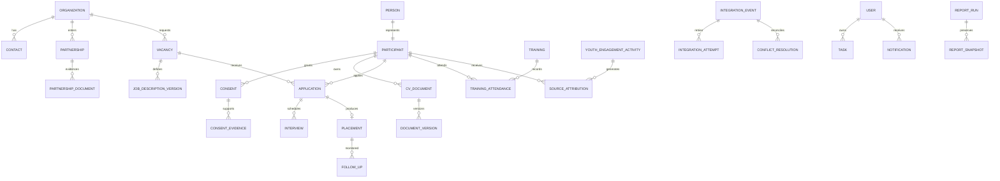

# HAPPY Operations Platform Readiness Audit

Audit date: 18 Oct 2026
Basis: current local `development` worktree at commit `defc1ca`, including
uncommitted changes through migration `0031_oidc_sso`.

## 1. Executive Audit Summary

### Decision

The platform is **development-ready**, but is **not integration-ready,
UAT-ready, or production-ready** for the complete operating model. It is more
than a visual prototype: core workflows, a versioned FastAPI API, PostgreSQL,
RBAC, audit and broad backend tests are real. HAMIS and Employer Portal have
secure local inbound adapters, but neither live frontend is connected and several
required records and operational controls remain incomplete.

### Complete or substantial

- Next.js/FastAPI/PostgreSQL modular monolith under `/api/v1`.
- Users, roles, action permissions, overrides, sessions, TOTP MFA, local OIDC,
  server-side authorization and integration-aware audit actors.
- Employer, vacancy, participant, consent, CV, application, interview, placement,
  MERL, training, marketing, work-management and reporting foundations.
- Guarded onboarding, submission, start and first-income placement rules.
- Private CV storage/versioning and advisory parser results requiring human review.
- Encrypted, idempotent local inbound contracts for both external systems.
- Database at `0031_oidc_sso` with no detected model drift.
- Fresh backend result: **273 passed**.

### Materially incomplete

- No live HAMIS/Portal forwarding, deployed credentials, durable retries,
  reconciliation, alerting or staging UAT.
- HAMIS only auto-applies basic new intake. Existing participant updates, consent,
  training and placement stop at review; full mapping and conflict rules are absent.
- Portal conversion does not operationalize signature/document IDs, return status,
  map acquisition lead, or model partnership type.
- No dedicated versioned JD document. Vacancy description is mutable text and
  `Document` is participant/CV-specific.
- Partnership is one row per organization and has no Training, Recruitment, or
  combined partnership classification.
- No dedicated youth engagement/outreach and source-attribution domain.
- Task/Handoff targets are unconstrained polymorphic UUIDs. Notifications are
  in-app only, without delivery, escalation or retry history.
- The central web app has no PWA manifest/service worker.
- Report jobs persist state but run in FastAPI `BackgroundTasks`.
- No verified production monitoring, backup schedule/restore, scanner, parser,
  identity provider or hosted deployment.
- The post-audit remediation restores Ruff, strict mypy and the full authenticated
  browser gate; the complete local `pnpm verify` run now passes.

### Highest risks

1. **P0:** no live end-to-end integration, recovery, reconciliation or conflicts.
2. **P0:** partnership history/types and JD versions cannot represent requirements.
3. **P1:** live provider and integration acceptance is still outstanding despite
   the restored local quality baseline.
4. **P0:** no verified provider backup, restore, monitoring or alert routing.
5. **P1:** privacy, retention, M&E definitions and field ownership remain open.

## 2. Evidence and Access Report

### Inspected

- Local `OffgengStudios/ATS` `development` branch and uncommitted implementation.
- V3 prototype at `C:\Users\jobbe\Downloads\index-1.html`.
- API modules, services, migrations, permissions, tests and Next.js workspaces.
- CI, Render blueprint, Dockerfiles, environment templates and runbooks.
- HAMIS repository HEAD `0389cbac...` and live frontend (HTTP 200).
- Employer Portal HEAD `59403b1e...` and live frontend (HTTP 200).

### Fresh verification

| Check | Result |
|---|---|
| Backend pytest with integrations | 273 passed, 1 warning |
| Alembic current/check | `0031` head; no drift |
| Ruff | Passed |
| strict mypy | Passed across 115 source files |
| Web TypeScript and ESLint | Passed |
| Next.js production build | Passed |
| Authenticated Playwright | 98 passed across desktop and mobile |
| Dependency audits | Python and JavaScript production audits passed |

Authenticated Playwright tests used the isolated fixture created by
`scripts/ci.py`; its API process and PostgreSQL schema were removed after the
successful run. See [the remediation evidence](49-QUALITY-BASELINE-RESTORATION.md).

### Limitations

- No staging/production Render, Neon, storage, scanner, parser, IdP, monitoring or
  backup-provider access was available.
- No live integration event or production personal data was used.
- Sheets/Drive records, consent evidence, the official M&E workbook and migration
  totals were unavailable for reconciliation.
- Provider TLS/encryption, RPO/RTO, alert delivery and restore were not verified.

## 3. Feature Completeness Matrix

| Module | Current state | Evidence | Main gap | Priority | Acceptance criterion |
|---|---|---|---|---|---|
| API/Foundation | Implemented and verified | `/api/v1`, migrations, tests | Hosted runtime | P1 | Reviewed staging deploy/migrate/smoke pass |
| Dashboard | Partial | Role workspaces/reporting | Accuracy/UAT refresh | P1 | Role figures reconcile to seeded DB |
| Employers | Verified locally | Demand models/API/tests | Rich engagement history | P2 | Ownership/duplicate UAT passes |
| Partnerships | Partial | Lifecycle fields | One per employer; no type/files | P0 | Multiple dated typed agreements with evidence |
| Jobs/JDs | Partial | Vacancy/history | No JD file/version/publication record | P0 | Immutable secure JD versions and approvals |
| Participants | Verified locally | Person/Participant/tests | Merge and approved policy | P1 | Controlled merge and policy UAT |
| Consent | Partial | Version/status/method | No evidence document | P0 | Private evidence, withdrawal and HAMIS reconciliation |
| CVs | Partial | Versioned files/parser review | Real providers and restart UAT | P1 | Scanner/parser E2E; no auto-overwrite |
| Applications | Verified locally | CandidateVacancy/history | Reapplication/merge UAT | P1 | Multi-job and reapplication rules pass |
| Interviews | Verified locally | Interview/history | Reminders/provider | P2 | Schedule/no-show/reschedule UAT |
| Placements | Verified locally | Start/income/history tests | HAMIS reconciliation/policy | P0 | Scenario C proves no double count |
| Marketing | Partial | Campaign/assets/stories | Asset versions/attribution | P1 | Secure versions and activity verified |
| Youth Engagement | Missing | No module found | Entire domain absent | P1 | Outreach links source to outcomes |
| Training | Verified locally | Session/attendance tests | HAMIS mapping | P1 | No-duplicate staging reconciliation |
| MERL | Partial | Follow-up/outcome/quality | Official workbook and snapshots | P0 | Golden data matches signed workbook |
| Reporting | Partial | KPI/export jobs | In-process work; no snapshots | P1 | Restart-safe, reproducible reports |
| Tasks/Handoffs | Partial | DB/API/UI/tests | Target integrity/escalation | P1 | Invalid target rejected; lifecycle UAT |
| Notifications | Partial | In-app records | No provider/outbox/escalation | P2 | Observable, retryable delivery |
| IAM/Admin | Verified locally | API tests/UI/current browser | Real IdP | P1 | Staging SSO/MFA passes |
| Central PWA | Missing | No manifest/worker | Responsive web only | P1 | Installability and cache-policy tests |

## 4. HAMIS Integration Audit

HAMIS remains a separate offline-capable frontend backed by Apps Script/Sheets.
HAPPY accepts server-side events with a bearer token, idempotency key, encrypted
inbox, integration audit actor and external references. Complete new basic intake
can create Person/Participant. Existing matches and consent/training/placement
events enter `NEEDS_REVIEW`.

Use a hybrid design: synchronous validation and durable receipt, followed by
asynchronous conversion/reconciliation and operator-visible retry state.

| HAMIS source | HAPPY destination | Current handling |
|---|---|---|
| HAMIS/participant ID | ExternalReference -> Participant | Implemented |
| Basic identity/contact/location | Person | Basic subset |
| Programme/employment/demographics | Participant/SensitiveProfile/Education | Mostly absent |
| Consent/evidence | Consent/private evidence | Staged only |
| Capacity building | Training/Attendance | Staged only |
| Placement | Application/Placement | Staged only |
| Offline write-event ID | Inbound idempotency key | Contracted, not live-tested |
| Corrections/conflicts | Review and history | Review flag only |

Missing: live sender, request signing/rotation, durable retry/dead-letter,
field-ownership matrix, apply-reviewed-update commands, duplicate merge, secure
evidence transfer, source-facing sync status, and reconciliation totals.

Transition safely by approving canonical mapping/null semantics first, running
non-production Apps Script forwarding with immutable IDs, adding durable processing
and reviewed conversions, then reconciling bounded historical batches. Keep
Sheets/Drive until programme, privacy, M&E and operations sign-off.

Acceptance requires scenarios A, D and E from non-production HAMIS; no duplicate
domain records on replay; authorized conflict resolution preserving both values;
private scanned consent evidence; and zero unexplained reconciliation differences.

## 5. Employer Portal Integration Audit

The encrypted/idempotent inbox and staff conversion into shared Organization,
Contact, Partnership, Vacancy and Requirement records are sound. Vacancies remain
`DRAFT`, correctly preventing automatic publication.

| Portal source | HAPPY destination | Current handling |
|---|---|---|
| Submission ID | ExternalReference -> Organization | Implemented |
| Company/contact | Organization/Contact | Implemented |
| Acquisition lead | Authorized owner | Not mapped |
| Partnership type | Partnership history/type | Missing |
| Signature/consent | Secure agreement evidence | Preserved only in encrypted payload |
| Vacancies | Draft Vacancy/Requirement | Partial |
| JD/documents | Versioned private documents | Missing |
| Review status | Portal status/confirmation | Missing |
| Failures/retries | Outbox/dead-letter/reconciliation | Missing |

Compensation is accepted but not converted to structured salary fields. Portal
vacancy IDs do not become external references. A safe target flow must resolve the
acquisition lead to an authorized user, create review records, process documents
through private scanning, and return a receipt plus safe status. Scenario B and D
must pass from the deployed non-production portal, including duplicates, lead,
type, files, multiple jobs and multiple partnership periods.

## 6. Architecture and Database Findings

The modular monolith is appropriate. Shared UUID records, versioned API,
transactions, optimistic versions, provenance, audit actors and external references
are strong. Required corrections are:

1. Make Organization-Partnership one-to-many with controlled type and dates.
2. Add generic private Document/DocumentVersion ownership or dedicated partnership
   and JD version records; do not overload CV rows.
3. Add integration attempts, next-attempt, terminal error, batch and resolution.
4. Add field-level conflict records and authorized resolution history.
5. Give Task/Handoff entity targets a controlled integrity strategy.
6. Add YouthEngagementActivity and SourceAttribution.
7. Add immutable ReportRun/ReportSnapshot metadata.
8. Link Consent to private evidence and retention/disposal state.

## 7. Security, Privacy and Permissions Audit

Implemented: Argon2, opaque hashed sessions, expiry/idle limits, CSRF/origin
checks, throttling, revocation, TOTP recovery, local OIDC, server-side action
permissions, separate machine actors, encrypted integration payloads and IDs,
private storage, upload limits, fail-closed scanning and sensitive-export controls.

Gaps:

- OIDC is type-clean locally but not provider-tested; no approved IdP/recovery operation.
- Integration bearer tokens lack signing, scoped lifecycle and rotation evidence.
- No approved retention, subject-access, correction, deletion/legal hold, breach
  response or backup-erasure procedure was verified.
- Consent evidence is not securely linked.
- Cloud TLS/encryption/IAM and trusted-proxy behavior are unverified.
- Audit values may be too sparse for conflict/forensic reconstruction.
- No current SAST, DAST or remote-history secret scan evidence.

Complete a Ghana Data Protection Act-focused review with the programme DPO/data
controller. This technical audit is not legal certification.

## 8. UI/UX and Accessibility Audit

The app follows the supplied recruitment-blue reference and has role-aware,
responsive desktop/mobile navigation, action panels, loading/error/empty states,
reduced motion and automated accessibility specifications. The V3 prototype is
useful interaction guidance but its sample data is not backend evidence.

Gaps: no central PWA/offline behavior; incomplete
integration retry/conflict/reconciliation journeys; arbitrary Task/Handoff targets;
no Youth Engagement, JD history, consent evidence or partnership-history flows;
large workspace components; and no fresh manual screen-reader, zoom, high-contrast
or real-device acceptance.

## 9. Testing and Quality Assurance Matrix

| Area | Current evidence | Required before release |
|---|---|---|
| Unit/API | 273 pass; static gates green | Missing mapping/conflict tests |
| Database | Head/no drift | Empty upgrade, policy and provider restore |
| RBAC | Broad API and 98 browser tests | Separation-of-duties UAT |
| Files | CV tests | JD/consent/partnership E2E with real providers |
| HAMIS | Local contract tests | Live staging retries/conflicts/reconciliation |
| Portal | Local conversion tests | Live files/lead/status/recovery E2E |
| M&E | KPI tests | Official-workbook golden-data reconciliation |
| Accessibility | Fresh desktop/mobile axe specs pass | Manual assistive-tech review |
| Security | Session/config tests | SAST/DAST/secret/IAM/penetration testing |
| Backup/DR | Local tooling | Scheduled off-site backup and timed restore |

| Mandatory scenario | Current state | Pass condition |
|---|---|---|
| A: HAMIS to Candidate | Partial | Preserve ID, dedupe, create candidate only by rule |
| B: Portal to Recruitment | Partial | Preserve lead/type/files and route draft for review |
| C: Candidate to Placement | Local pass | Update verified outcome once, preserve history |
| D: Failed Integration | Designed only | Durable retry/status/alert with no duplicate |
| E: Conflicting Updates | Not implemented | Apply ownership rule and preserve resolution history |

Also test historical migration reconciliation, HAMIS offline recovery, merge,
malformed/infected files, concurrency, worker restart, 200% zoom, real mobile,
retention/deletion and disaster recovery.

## 10. Prioritised Remediation Backlog

### P0 - Production blockers

1. Implement partnership type/history and secure JD/document versions.
2. Approve HAMIS mappings/ownership/conflicts/consent evidence and conversions.
3. Complete Portal lead/type/document/status mapping and durable recovery.
4. Validate the official M&E workbook with golden datasets and signed totals.
5. Provision staging providers, alerts, backups and a recorded restore exercise.

### P1 - MVP requirements

- Youth Engagement/source attribution.
- Task/Handoff target integrity and escalation.
- Restart-safe parser, report and integration processing.
- Staging SSO/MFA recovery and deactivation UAT.
- PWA installability and explicit offline policy.
- Duplicate merge/external-reference reassignment.
- Immutable report runs/snapshots.

### P2 - Important improvements

- Notification provider/outbox after policy approval.
- Safe audit snapshots for high-risk changes.
- Smaller frontend components and focused component tests.
- Integration operations dashboard/SLA reporting.
- Trusted proxy and machine-credential rotation verification.

### P3 - Future

- Additional integrations after stable contracts.
- Advanced attribution/forecasting after methodology approval.
- Trace-led performance tuning and capacity tests.

## 11. Definition of Done

A module is done only when schema constraints, service rules, server permissions,
audit, API, responsive UI, failures, migrations, tests, docs and operational owner
all pass. The platform is done when all P0/P1 items are accepted; root CI is green
from a protected immutable commit; every workflow has signed UAT; scenarios A-E
pass in staging with zero unexplained reconciliation differences; M&E reproduces
approved workbook totals; provider scanner/parser/IdP/alerts/backups/restores meet
RPO/RTO; privacy/retention/incident policies operate; accessibility passes; and
deployment/rollback/support runbooks have been exercised by operators.

## 12. Final Readiness Decision

| Category | Decision | Basis |
|---|---|---|
| Prototype-ready | **Pass** | V3 and app demonstrate the operating model |
| Development-ready | **Pass** | Real domains/API/database/tests support work |
| Integration-ready | **Fail** | Mapping, files, recovery, conflicts and live contracts incomplete |
| UAT-ready | **Fail** | Local gates pass, but no representative live environment or signed UAT |
| Production-ready | **Fail** | Data, privacy, provider and operational blockers remain |

HAPPY can become the reliable unified internal source of truth without replacing
the modular-monolith architecture. It cannot yet operate reliably with HAMIS and
the Employer Portal as production systems. The local quality-gate remediation is
complete; the remaining domain, integration and provider work should follow the
priorities above with explicit acceptance evidence.
